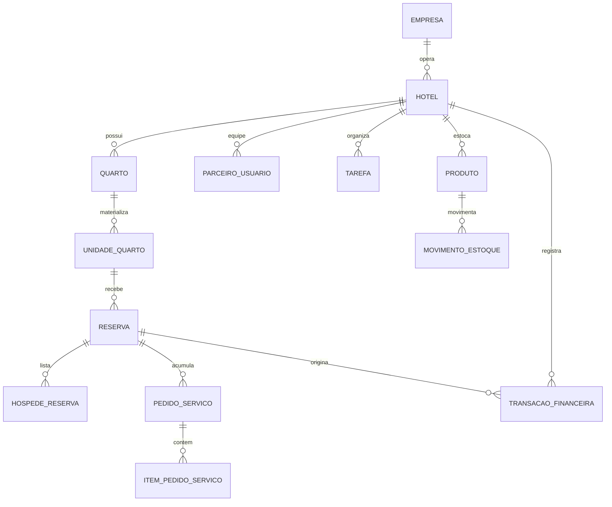

# Referência técnica completa: NAVIE Hospedagens → DJUMBI

> Inventário funcional e técnico do sistema interno **Naviê Hospedagens**, com guia de reaproveitamento arquitetural para o DJUMBI.
>
> Fontes analisadas: `NAVIE/hoteis/models.py`, `hoteis/views.py`, `hoteis/urls.py`, `hoteis/middleware.py`, `core/middleware.py`, `financeiro/`, `estoque/`, `templates/hoteis/base_partner.html` e templates parciais de hospedagem.

## 1. O que é o Naviê Hospedagens

É um PMS (Property Management System) integrado a um portal de vendas. Há duas faces que compartilham as mesmas entidades:

```text
Portal público (B2C)                         Painel interno (B2B)
─────────────────────                       ──────────────────────
Home / vitrine                              Dashboard operacional
Hotel e acomodações                         Quartos e tarifas
Busca de disponibilidade                    Reservas / timeline
Carrinho e checkout                         Check-in e checkout
Pix / cartão                                Hóspedes e pedidos
Comprovante / voucher                       Financeiro, estoque, tarefas
                                             Equipe, permissões e CMS
```

O dado que conecta ambas é a **Reserva**, criada para uma **UnidadeQuarto** (quarto físico), derivada de uma **categoria Quarto** (tipo de acomodação) de um **Hotel**.

## 2. Mapa de código NAVIE

| Local | Responsabilidade | Reaproveitamento no DJUMBI |
| --- | --- | --- |
| `hoteis/models.py` | Domínio hoteleiro e regras de tarifa | Referência de modelagem e serviços de domínio |
| `hoteis/views.py` | Portal, checkout, dashboard, HTMX e operações | Quebrar em views/services menores |
| `hoteis/urls.py` | Rotas públicas e B2B | Referência de endpoints, com nomes mais consistentes |
| `hoteis/templates/hoteis/base_partner.html` | Shell B2B, sidebar, tabs, IA e tema | Inspirar `templates/app/base_shell.html` do DJUMBI |
| `hoteis/templates/hoteis/partials/` | Reservas, pedidos e quartos reativos | Padrão para fragmentos HTMX |
| `financeiro/models.py` | Transações, anexos e auditoria de pagamento | Evoluir como módulo transversal do DJUMBI |
| `estoque/models.py` | Produtos, compras e movimentações | Reaproveitar no Agro/Engenharia quando necessário |
| `core/middleware.py` | Contexto por subdomínio | Não copiar; usar contexto de organização da sessão |
| `hoteis/middleware.py` | Troca de hotel para usuários globais | Transformar em troca segura de organização/unidade |

## 3. Entidades e relações



### 3.1 Catálogo, marca e contexto

| Entidade | Campos/conceitos principais | Observação |
| --- | --- | --- |
| `Empresa` (`core`) | dados comerciais, marca e domínio | Dona lógica da operação; no DJUMBI equivale a `Organization` |
| `Hotel` | empresa, nome, descrição, endereço, status, marca, mídia, venda online, comissões | Operação de hospedagem de uma empresa |
| `Local` | nome, endereço, cidade, UF | Pode ser absorvido por `Unit`/endereço no novo projeto |
| `Produtor` | nome público | Entidade simples; no DJUMBI seria contato/fornecedor ou perfil da organização |
| `HotelImagem` | hotel, imagem, ordem | Galeria da vitrine |
| `HomeSlide` / `HotelSecao` / `HotelSecaoItem` | conteúdo e links da página pública | CMS da operação, útil só se o DJUMBI tiver mini-sites por cliente |
| `Cidade` | dados de cidade e destaque | Recurso de marketplace, não necessário no núcleo DJUMBI |

### 3.2 Inventário de acomodações

| Entidade | Papel | Campos e regras importantes |
| --- | --- | --- |
| `Quarto` | Categoria vendável: “Suíte Master”, “Chalé 2” | preço base, capacidade, hóspedes inclusos/extras, comodidades, vídeo, SEO, preços por dia da semana, descontos progressivos |
| `QuartoImagem` | Galeria da categoria | imagem e ordem |
| `UnidadeQuarto` | Quarto físico: “101”, “Chalé 05” | ativa, disponível, motivo e justificativa de indisponibilidade |
| `BloqueioQuarto` | Bloqueio temporal de uma unidade | período e motivo; impede venda futura |
| `TarifaEspecial` | Exceção de preço por período | início, fim, preço e preço de hóspede adicional |
| `HotelTarifaFaixa` | Faixas administrativas de taxa | regra de comissão/plataforma, não de preço público |

**Separação que precisa ser mantida:** `Quarto` não é o quarto físico. Ele é o produto/categoria. A `UnidadeQuarto` é o recurso escasso que pode ser reservado, bloqueado, ocupado, limpo ou entrar em manutenção.

### 3.3 Reserva e portaria

| Entidade | Papel | Estados / comportamento |
| --- | --- | --- |
| `Reserva` | Contrato operacional de estadia | UUID, unidade, datas, valores, origem, pagamento, FNRH, status e repasses |
| `HospedeReserva` | Pessoas adicionais | nome, documento, data de nascimento e demais dados de registro |
| `VeiculoReserva` | Veículo ligado à estadia | placa, modelo, cor e observações |
| `ReservaLog` | Histórico operacional | quem mudou, ação, data e observação |
| `HotelDocumento` | Documentos do hotel | anexos administrativos/contratuais |
| `HotelTermoAdesao` | termo de adesão | assinatura/aceite da operação |
| `HotelAuditLog` | auditoria da operação | histórico administrativo do hotel |

Estados atuais da reserva:

```text
pendente ──pagamento/validação──> confirmada ──check-in──> hospedado ──check-out──> concluido
     └───────────────────────────────────────> cancelada
confirmada ──────────────────────────────────> cancelada
```

No DJUMBI, implemente transições em um **serviço de domínio**, não diretamente em cada view. A transição deve validar papel, período, disponibilidade, pagamento quando aplicável e criar evento/auditoria na mesma transação de banco.

### 3.4 Pessoas, equipe e operação

| Entidade | Papel | Conteúdo |
| --- | --- | --- |
| `ParceiroUsuario` | Membro da equipe do hotel | usuário Django, hotel principal, hotéis adicionais, CPF, foto, ativo e papel |
| `Tarefa` | Trabalho operacional | título, descrição, prioridade, status, prazo, responsável, unidade e reserva |
| `ProdutoConsumo` | Item vendável/consumível | nome, preço, estoque e vínculo com hotel |
| `PedidoServico` | Pedido do hóspede | reserva, status, itens, valor total e observações |
| `ItemPedidoServico` | Linha de um pedido | produto, quantidade e valor |

Papéis atuais: `proprietario`, `gerente`, `portaria`, `camareira` e `manutencao`. Eles orientam o menu e as ações: financeiro é restrito a proprietário/gerente; recepção lida com reservas/check-in; limpeza e manutenção recebem tarefas ligadas a unidades.

### 3.5 Financeiro e estoque acoplados

O painel usa apps próprios, mas o escopo sempre passa pelo hotel:

- `financeiro.TransacaoFinanceira`: receita/despesa, categoria, reserva/unidade opcional, vencimento/pagamento, parcelamento, fornecedor, anexos e status de pagamento.
- `financeiro.AnexoTransacao`: comprovante/documento anexado.
- `financeiro.MercadoPagoConexao` e `AuditoriaPagamento`: integração de gateway e trilha de eventos de pagamento.
- `estoque.CategoriaProduto`, `Fornecedor`, `Produto`, `Compra`, `DocumentoCompra`, `ItemCompra` e `MovimentoEstoque`: compras, lotes, validade, entradas, saídas, perdas e estoque mínimo.

No DJUMBI, estes módulos devem ser transversais e receber `organization_id` e, quando necessário, um objeto de contexto (`obra`, `processo`, `safra`, `unidade`).

## 4. Regras de negócio que vale copiar

### 4.1 Cálculo de estadia

O método `Quarto.calcular_valor_estadia()` usa:

1. `checkout - checkin` para calcular noites;
2. preço padrão por dia da semana do check-in;
3. tarifa especial para cada noite quando houver período correspondente;
4. acréscimo por hóspede extra;
5. desconto progressivo por quantidade de noites;
6. retorno detalhado: subtotal, adicional, desconto, total e noites.

Para uma implementação mais segura, use uma tabela de tarifa normalizada em vez de sete colunas de dia da semana, e persista o **snapshot de preços** dentro da reserva. Dessa forma, alterações futuras de tarifa não mudam o valor de reservas antigas.

```python
# Exemplo de serviço para o DJUMBI (adapte o domínio; não dependa da view)
@transaction.atomic
def confirmar_reserva(*, reserva, actor):
    authorize(actor, "booking.confirm", organization=reserva.organization)
    if reserva.status != Reservation.Status.PENDING:
        raise DomainError("A reserva não está pendente.")
    ensure_unit_available(reserva.unit, reserva.check_in, reserva.check_out, exclude_id=reserva.id)
    reserva.status = Reservation.Status.CONFIRMED
    reserva.confirmed_at = timezone.now()
    reserva.save(update_fields=["status", "confirmed_at", "updated_at"])
    audit(actor=actor, action="booking.confirmed", target=reserva)
    return reserva
```

### 4.2 Disponibilidade correta

Uma unidade está indisponível se qualquer condição for verdadeira:

- está inativa;
- está marcada em manutenção/limpeza;
- possui bloqueio que intersecta o período consultado;
- possui outra reserva `pendente`, `confirmada` ou `hospedado` com intervalo sobreposto.

Use a regra de interseção: `reserva.checkin < consulta.checkout AND reserva.checkout > consulta.checkin`. Para evitar dupla reserva, faça a confirmação dentro de `transaction.atomic()` e bloqueie o recurso (`select_for_update`) ou use constraint de exclusão do PostgreSQL para intervalos.

### 4.3 Check-in e check-out

**Check-in** deve validar reserva confirmada, identidade/documentos mínimos, unidade disponível e data/política. Em seguida: atualiza para `hospedado`, preenche instante real, registra log e muda unidade para ocupada por derivação da reserva.

**Check-out** deve consolidar consumos/pedidos, calcular saldo final, exigir tratamento de pendências, mudar para `concluido`, registrar instante e criar tarefa de limpeza. Não “libere” a unidade automaticamente se a política operacional exige limpeza; deixe o estado derivar de tarefa/status de housekeeping.

### 4.4 Tarefas operacionais

O NAVIE oferece Kanban e calendário para `Tarefa`, associando-a a unidade e reserva. É um bom padrão para DJUMBI:

- criar tarefas automaticamente após eventos (checkout → limpeza; unidade indisponível → manutenção);
- separar estado da tarefa de estado do recurso;
- permitir responsável, prazo, prioridade, checklist, comentários e anexos;
- auditar reatribuições e conclusão.

## 5. Rotas existentes do Naviê

As rotas abaixo formam o contrato funcional do módulo. No DJUMBI, prefira nomes por domínio e métodos HTTP explícitos; elas são um inventário, não um convite para copiar as URLs literalmente.

### 5.1 Portal e disponibilidade

| Rota NAVIE | Finalidade |
| --- | --- |
| `/` | Home e vitrine de hotéis |
| `/hotel/<id>/` | Detalhe público da hospedagem |
| `/hotel/<id>/acomodacao/<slug>/` | Detalhe de categoria de acomodação |
| `/api/hotel/<id>/check_disponibilidade/` | Consulta de disponibilidade |
| `/api/hotel/<id>/datas_ocupadas/` | Datas sem disponibilidade |
| `/cidade/<slug>/` | Página pública de destino |
| `/acomodacao/<slug>/` | Detalhe em contexto de subdomínio |

### 5.2 Acesso e painel B2B

| Rota NAVIE | Finalidade |
| --- | --- |
| `/hospedagens/auth/` | Login do parceiro |
| `/hospedagens/logout/` | Encerramento de sessão |
| `/hospedagens/sistema/` | Dashboard e shell do painel |
| `/hospedagens/ia_chat/` | Assistente interno |
| `/hospedagens/configuracoes/salvar/` | Marca/conteúdo da operação |
| `/hospedagens/configuracoes/geral/salvar/` | Configuração de grupo/empresa |
| `/hospedagens/equipe/...` | criar, editar, inativar e ajustar permissões |

### 5.3 Quartos, tarifas e mapa

| Rota NAVIE | Finalidade |
| --- | --- |
| `/hospedagens/quartos/formulario[/<id>/]` | Fragmento/formulário HTMX da acomodação |
| `/hospedagens/quartos/lista/` | Lista/grade reativa |
| `/hospedagens/quartos/tarifas-calendario/` | Calendário de tarifas |
| `/hospedagens/quartos/tarifa-especial/salvar/` | Grava exceção de preço |
| `/hospedagens/quartos/salvar/` | Cria/edita categoria e unidades |
| `/hospedagens/quartos/liberar/<id>/` | Libera unidade operacionalmente |
| `/hospedagens/quartos/atualizar-disponibilidade/<id>/` | Marca limpeza/manutenção/outro |
| `/hospedagens/quartos/detalhe-modal/<id>/` | Modal de detalhe da unidade |

### 5.4 Reserva, recepção e hospedagem

| Rota NAVIE | Finalidade |
| --- | --- |
| `/hospedagens/reservas/criar/` | Reserva interna/walk-in |
| `/hospedagens/reservas/verificar-disponibilidade/` | Busca unidade livre |
| `/hospedagens/reservas/<uuid>/` | Detalhe/modal da reserva |
| `/hospedagens/reservas/<uuid>/salvar/` | Atualização de dados |
| `/hospedagens/reservas/<uuid>/checkin/` | Check-in operacional |
| `/hospedagens/reservas/<uuid>/checkout/` | Check-out operacional |
| `/hospedagens/reservas/<uuid>/cancelar/` | Cancelamento |
| `/hospedagens/reservas/<uuid>/voucher/` | Comprovante imprimível |
| `/hospedagens/validador/buscar/` | Busca rápida por código/nome |
| `/hospedagens/validador/<uuid>/checkin/` | Check-in via validador |

### 5.5 Hóspedes, consumo e tarefas

| Rota NAVIE | Finalidade |
| --- | --- |
| `/hospedagens/hospedes/pedidos/` | Central de pedidos |
| `/hospedagens/hospedes/pedido/<id>/status/` | Atualiza pedido |
| `/hospedagens/hospedes/reserva/<uuid>/lancar/` | Lança consumo na reserva |
| `/hospedagens/atividades/criar/` | Cria tarefa |
| `/hospedagens/atividades/editar/<id>/` | Edita tarefa |
| `/hospedagens/atividades/mudar-status/<id>/` | Move Kanban |
| `/hospedagens/atividades/deletar/<id>/` | Remove tarefa |

### 5.6 Venda e pagamento

| Rota NAVIE | Finalidade |
| --- | --- |
| `/carrinho/adicionar/<id>/` | Inicia carrinho público |
| `/carrinho/salvar-fnrh/` | Dados de registro do hóspede |
| `/carrinho/hospedes/definir/` | Hóspedes adicionais |
| `/carrinho/veiculo/salvar/` | Dados do veículo |
| `/carrinho/checkout/` | Cria/processa cobrança |
| `/carrinho/sucesso/<uuid>/` | Confirmação |
| `/hospedagens/reservas/fast-pix/<id>/` | Pagamento direto por Pix |
| `/hospedagens/reservas/status/<uuid>/` | Consulta de estado do pagamento |
| `/hospedagens/financeiro/mp/...` | OAuth, callback, webhook e desconexão do gateway |

## 6. Painel interno: composição de interface

O `base_partner.html` centraliza o painel com Alpine.js, Tailwind, HTMX e Lucide. O padrão visual é:

```text
App shell
 ├── Sidebar recolhível
 │    ├── Financeiro                  (proprietário / gerente)
 │    ├── Quartos & Tarifas
 │    ├── Reservas
 │    ├── Gestão de estoque
 │    ├── Organização / Tarefas
 │    ├── Equipe & permissões
 │    ├── Atendimento / hóspedes
 │    └── Configurações do site
 ├── Menu reduzido por função
 │    ├── Check-in / validador
 │    ├── Mapa de quartos
 │    ├── Limpeza
 │    └── Ordens de serviço
 ├── Topbar: contexto do hotel/grupo, tab e tema
 ├── Conteúdo por tab
 └── Assistente de IA contextual
```

Os fragmentos mais úteis são:

- `quartos/partials/quarto_grid.html`, `quarto_mapa.html`, `quarto_formulario.html`, `tarifas_calendario.html`;
- `partials/reservas_grid.html`, `reservas_timeline.html`, `modal_reserva_form.html`, `modal_reserva_detalhe.html`;
- `atividades/partials/kanban.html`, `calendario.html`, `modal_tarefa.html`;
- `partials/pedidos_lista.html` e `pedido_card.html`.

### Como transformar esse painel em componente DJUMBI

O DJUMBI já possui `templates/app/base_shell.html`. Ele deve virar o único shell de super app:

```django
{# templates/app/base_shell.html #}


<div class="app-shell" data-theme="{{ request.user.profile.theme }}">
  
  <main id="workspace" tabindex="-1">
    
    
  </main>
</div>

```

Cada super app fornece uma configuração de menu e uma página workspace; não deve criar um novo `base_partner.html` copiado.

## 7. Código-base reutilizável para o DJUMBI

O objetivo não é importar o app `hoteis` inteiro para o DJUMBI. Ele contém marketplace, pagamento e subdomínio específicos do NAVIE. Abaixo está a forma segura de reaproveitar o padrão.

### 7.1 Organização e membership (núcleo)

```python
# apps/core/models.py — padrão de isolamento
class Membership(models.Model):
    class Role(models.TextChoices):
        OWNER = "owner", "Proprietário"
        MANAGER = "manager", "Gestor"
        OPERATOR = "operator", "Operador"
        VIEWER = "viewer", "Consulta"

    user = models.ForeignKey(settings.AUTH_USER_MODEL, on_delete=models.CASCADE)
    organization = models.ForeignKey("core.Organization", on_delete=models.CASCADE)
    role = models.CharField(max_length=20, choices=Role.choices)
    is_active = models.BooleanField(default=True)

    class Meta:
        constraints = [models.UniqueConstraint(fields=["user", "organization"], name="unique_membership")]
```

### 7.2 Serviço de mudança de estado

```python
# apps/core/services.py
from django.db import transaction

@transaction.atomic
def transition(*, instance, target_status, actor, permission, transition_map):
    require_permission(actor, permission, instance.organization)
    allowed = transition_map.get(instance.status, set())
    if target_status not in allowed:
        raise ValidationError("Transição de estado inválida.")
    old_status = instance.status
    instance.status = target_status
    instance.save(update_fields=["status", "updated_at"])
    AuditLog.objects.create(
        organization=instance.organization,
        actor=actor,
        action=f"{instance._meta.label_lower}.status_changed",
        metadata={"before": old_status, "after": target_status, "id": str(instance.pk)},
    )
    return instance
```

### 7.3 HTMX com permissão no servidor

```python
# apps/engineering/views.py — padrão para qualquer super app
@login_required
@require_http_methods(["POST"])
def task_status(request, pk):
    task = get_object_or_404(Task.objects.for_membership(request.membership), pk=pk)
    transition(
        instance=task,
        target_status=request.POST["status"],
        actor=request.user,
        permission="task.change_task",
        transition_map=TASK_TRANSITIONS,
    )
    return render(request, "components/task_card.html", {"task": task})
```

### 7.4 Modelagem equivalente por super app

| NAVIE Hospedagens | Engenharia DJUMBI | Jurídico DJUMBI Office | Agro DJUMBI |
| --- | --- | --- | --- |
| Hotel | Organização / obra | Escritório / cliente | Fazenda / unidade produtiva |
| Quarto | Tipo de frente/serviço | Tipo de caso/serviço | Cultura/atividade |
| UnidadeQuarto | Frente de obra / equipamento | Processo/caso | Talhão / lote / máquina |
| Reserva | Contrato/medição/agendamento | Processo/compromisso | Ordem operacional/safra |
| TarifaEspecial | Aditivo/tabela de custo | Honorário/tabela | custo/planejamento de insumo |
| Tarefa | Tarefa de campo | Prazo/tarefa | Operação agrícola |
| PedidoServico | Solicitação de obra | Solicitação do cliente | Requisição operacional |
| Estoque | Materiais de obra | materiais de escritório | insumos/lotes agrícolas |

## 8. O que precisa melhorar antes de reaproveitar

| Ponto NAVIE | Risco | Decisão DJUMBI |
| --- | --- | --- |
| `hoteis/views.py` concentra muitos milhares de linhas | difícil testar e manter | separar por `public`, `booking`, `frontdesk`, `inventory`, `settings`, `team` e services |
| Perfis e permissões por condicionais de template | risco de autorização inconsistente | RBAC no servidor, escopo por organização/unidade/projeto |
| subdomínio resolve várias entidades com consultas | acoplamento e complexidade | contexto persistido em sessão + seletor de organização |
| `db_constraint=False` em relações sensíveis | perda de integridade referencial | usar FKs reais e migrações consistentes |
| valores atuais de tarifa na categoria | histórico pode mudar | snapshot financeiro no registro transacional |
| disponibilidade baseada só em código da aplicação | risco de overbooking | transação, lock/constraint PostgreSQL e testes concorrentes |
| segredos em settings | incidente de segurança | `.env`, secret manager, rotação e nenhum segredo em Git |
| funções de IA dentro da view | difícil controlar dados | serviço de IA com escopo, fonte, logs, opt-in e limite de custo |

## 9. Checklist de portabilidade para o DJUMBI

- [ ] Não copiar `.env`, banco SQLite, tokens, chaves, SMTP, Mercado Pago ou credenciais do NAVIE.
- [ ] Não copiar `hoteis/views.py` inteiro; portar somente regras validadas para serviços pequenos.
- [ ] Criar testes de isolamento entre duas organizações antes de criar novos módulos.
- [ ] Criar testes de transição de estados e de concorrência para recursos escassos.
- [ ] Implementar `AuditLog` para ações, exportações, mudança de contexto e permissões.
- [ ] Usar UUIDs apenas onde há exposição externa ou integração; PK interno simples continua válido.
- [ ] Criar componentes de tabela, formulário, modal, empty state e sidebar uma vez só.
- [ ] Fazer cada super app declarar seu menu, permissões e home em configuração central.
- [ ] Carregar Tailwind compilado no pipeline; versionar dependências front-end.
- [ ] Validar acessibilidade, LGPD, backups e restauração antes de produção.

## 10. Ordem prática para usar esta referência

1. Leia `docs/arquitetura.md` e mantenha o núcleo atual do DJUMBI como fonte de verdade.
2. Use a seção 7 para padronizar serviços, permissões e fragmentos HTMX.
3. Implemente no primeiro super app apenas um fluxo completo: entidade principal → tarefa → evidência → aprovação → relatório.
4. Só depois leve os padrões de financeiro, anexos, estoque e IA para os três super apps.
5. Quando precisar de uma funcionalidade específica, consulte o arquivo NAVIE indicado na seção 2 e porte a regra com testes, sem acoplar o DJUMBI ao domínio de hospedagens.

## 11. Arquivos NAVIE a consultar na implementação

```text
C:\Users\const\OneDrive\Desktop\NAVIE\hoteis\models.py
C:\Users\const\OneDrive\Desktop\NAVIE\hoteis\views.py
C:\Users\const\OneDrive\Desktop\NAVIE\hoteis\urls.py
C:\Users\const\OneDrive\Desktop\NAVIE\hoteis\templates\hoteis\base_partner.html
C:\Users\const\OneDrive\Desktop\NAVIE\hoteis\templates\hoteis\partials\
C:\Users\const\OneDrive\Desktop\NAVIE\hoteis\templates\hoteis\quartos\partials\
C:\Users\const\OneDrive\Desktop\NAVIE\financeiro\models.py
C:\Users\const\OneDrive\Desktop\NAVIE\estoque\models.py
```

Esses arquivos são a fonte de detalhe do domínio NAVIE. Este documento é a camada de tradução: conserva o que é valioso — painel modular, estados operacionais, tarefas, estoque e financeiro — sem transportar acoplamentos e riscos para o DJUMBI.
